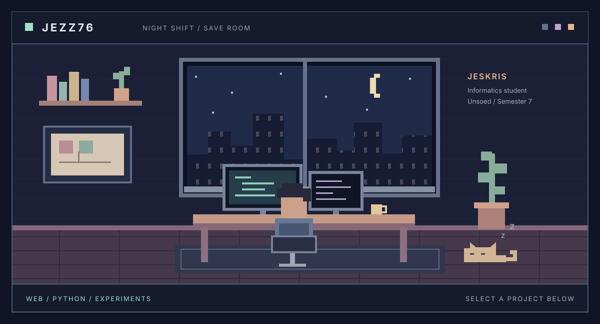

  

  <a href="https://github.com/Jezz76?tab=repositories"><b>SELECT PROJECT</b></a>
  &nbsp; / &nbsp;
  <a href="https://github.com/Jezz76/KP-Daily">KP-Daily</a>
  &nbsp; · &nbsp;
  <a href="https://github.com/Jezz76/EmailClassifier">EmailClassifier</a>
  &nbsp; · &nbsp;
  <a href="https://github.com/Jezz76/manajemen-film-laravel">Film Manager</a>

<a href="https://www.linkedin.com/in/jeskris-silahooy/">LINKEDIN</a> &nbsp; / &nbsp; <a href="https://github.com/Jezz76?tab=repositories">ALL REPOSITORIES</a>

