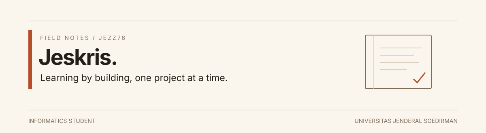

### Halo, gw Jeskris.

Mahasiswa **Informatika semester 7 di Universitas Jenderal Soedirman**. Lagi belajar membangun aplikasi web, mencoba otomasi dengan Python, dan mendalami computer vision untuk tugas akhir.

GitHub ini tempat gw nyimpen tugas kuliah, proyek pribadi, dan eksperimen. Sebagian masih sederhana atau belum selesai—gw pengen pelan-pelan bikin hasilnya lebih rapi, bisa dijalankan, dan lebih gampang dipahami orang lain.

[GitHub repositories](https://github.com/Jezz76?tab=repositories) · [LinkedIn](https://www.linkedin.com/in/jeskris-silahooy/)

---

### 01 / Di meja belajar

| Area | Yang lagi gw pelajari |
| :--- | :--- |
| **Web development** | Laravel, React, dan TypeScript untuk bikin aplikasi dan antarmuka web. |
| **Automation** | Python dan Playwright untuk mencoba mengurangi pekerjaan berulang. |
| **Computer vision** | YOLO dan PyTorch sebagai bagian dari eksplorasi tugas akhir. |

Ini arah belajar gw, bukan daftar teknologi yang semuanya sudah gw kuasai.

### 02 / Beberapa hasil latihan

**[KP-Daily](https://github.com/Jezz76/KP-Daily)**  
Aplikasi Laravel untuk mencatat kegiatan kerja praktik. Tempat latihan menyusun fitur pencatatan dan tampilan dashboard.

**[EmailClassifier](https://github.com/Jezz76/EmailClassifier)**  
Eksperimen klasifikasi email spam dengan Naive Bayes dan Flask. Belajar menghubungkan pengolahan teks, model klasifikasi, dan aplikasi web.

**[Manajemen Film — Laravel](https://github.com/Jezz76/manajemen-film-laravel)**  
Latihan aplikasi pengelolaan data film dengan Laravel.

Proyek-proyek ini menunjukkan proses belajar; bukan klaim sistem produksi atau produk komersial.

### 03 / Catatan buat diri sendiri

- Bisa jalan dulu, lalu pahami kenapa bisa jalan.
- Kalau pakai library atau bantuan AI, tetap pelajari dan uji hasilnya.
- Lebih baik sedikit fitur yang jelas daripada banyak fitur yang belum beres.
- Dokumentasikan cara menjalankan proyek dan bagian yang masih perlu diperbaiki.

---

Belum punya semua jawabannya. Lagi belajar supaya bisa bikin sesuatu yang berguna.
